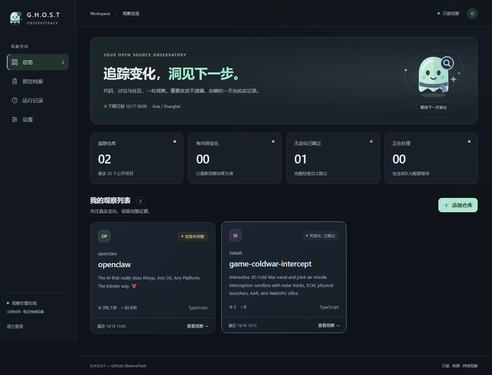
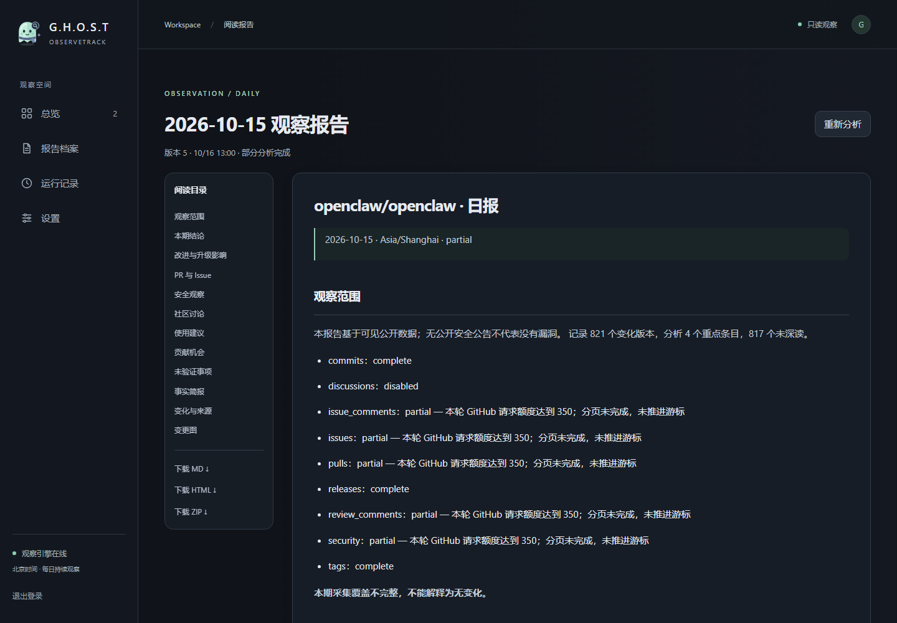
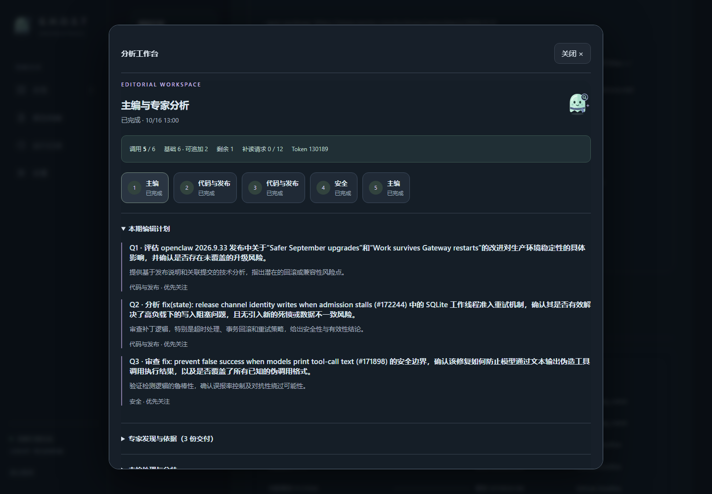
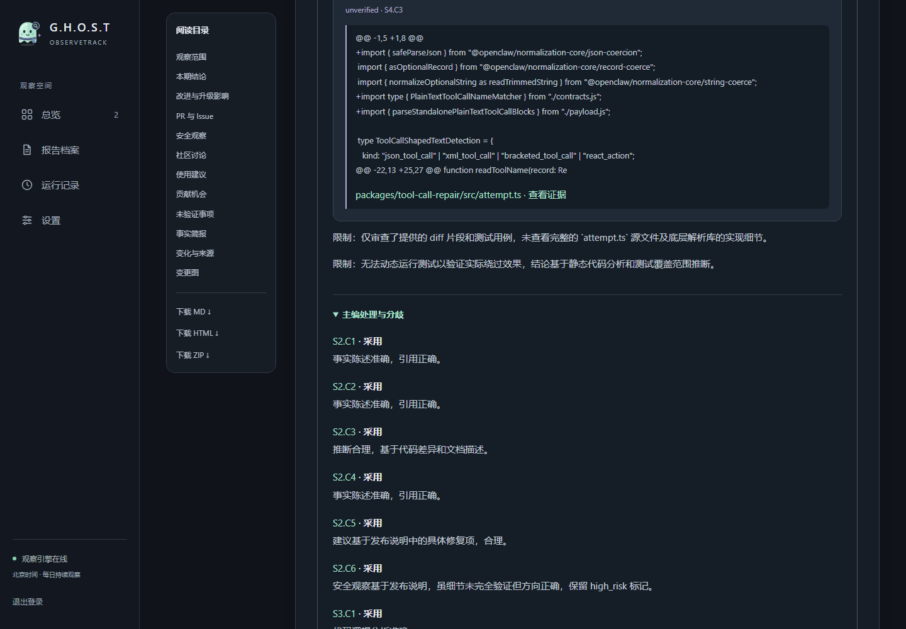
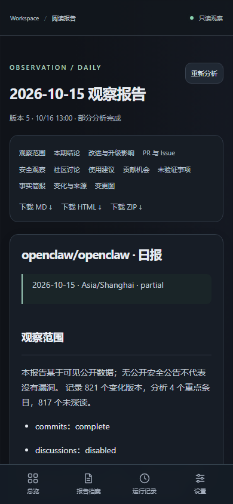
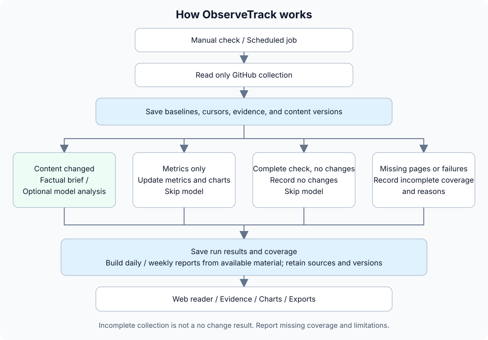

<div align="center">

# ObserveTrack

### Follow the changes. Keep the evidence.

Public GitHub monitoring · Traceable evidence · Daily & weekly reports

[简体中文](README.md) · **English**

[](LICENSE)
[](requirements.txt)
[](frontend/package.json)
[](#github-access)

[Screenshots](#real-screenshots-and-report-output) · [Quick start](#quick-start) · [How it works](#how-it-works) · [Configuration](#configuration-reference) · [Deployment](docs/DEPLOYMENT.md)

</div>

---

ObserveTrack is a self hosted workspace for monitoring public GitHub repositories. It collects code, release, and community activity on a schedule, saves changes and evidence, and optionally uses a model to produce reports. Start with the overview, read a report, then follow its references to check the underlying material.

Use it to follow dependencies, understand upstream releases, prepare technical briefings, or maintain a timeline of project activity. Without a configured model, collection and factual briefs remain available.

> GitHub access is read only: ObserveTrack does not create comments, Issues, or PRs. It does not include a general chatbot or code execution sandbox. **The current UI and default reports are in Chinese.** Full English and Chinese documentation does not imply an English UI.

| Discover changes | Understand changes | Keep the evidence |
| :--- | :--- | :--- |
| Collect nine activity dimensions; distinguish content from metric changes | Choose factual briefs or optional editor / expert analysis | Retain evidence, coverage, and historical report versions |

## Find your way

- **Explore the product:** [Screenshots](#real-screenshots-and-report-output) → [Features](#features) → [How it works](#how-it-works)
- **Run it yourself:** [Quick start](#quick-start) → [First run checklist](#first-run-checklist) → [Configuration](#configuration-reference)
- **Interpret results:** [Using the workspace](#using-the-workspace) → [Reading a report](#reading-a-report) → [Collection status reference](#collection-status-reference)
- **Maintain or contribute:** [Data and deployment](#data-deployment-and-maintenance) → [Project layout](#project-layout) → [Development](#development-and-verification)

## Real screenshots and report output

These are **authentic screenshots from historical runs in October 2026**, not mockups or current live data. They retain the original GHOST branding; the public edition continues this interface. Examples concern public repositories, and conclusions still require checking against evidence. See [screenshot provenance](docs/images/README.md) for details and original images.

### Repository overview

See tracked repositories, change status, collection progress, and upcoming schedules. “No changes” and “incomplete collection” are displayed separately.



### Generated daily report and coverage

Reports include scope, changes, conclusions, recommendations, unverified items, and sources. This actual report recorded **821 change versions, with 4 priority items analyzed and 817 not examined in depth**. It explicitly says `partial`; it is not presented as a comprehensive audit.

<details>
<summary><strong>Open the real daily report: scope, analysis counts, and coverage</strong></summary>



</details>

### Optional editor and expert analysis

The analysis workspace shows research questions, stage progress, call budgets, and expert deliveries. This historical run used **5 model calls**. That is one observed result, not a fixed cost per report.

<details>
<summary><strong>Open the editorial workspace: questions, expert stages, and usage</strong></summary>



</details>

### Evidence and limitations in the report

Reports show cited code excerpts, evidence links, editorial decisions, and limitations. This example explicitly states that analysis used static diff excerpts and did not run dynamic tests.

<details>
<summary><strong>Open report details: source excerpts, editorial decisions, and limitations</strong></summary>



</details>

<details>
<summary>View the actual mobile report</summary>



</details>

## Features

| Capability | What it does |
| --- | --- |
| Public repository monitoring | Track up to 20 repositories, with manual checks and scheduled collection |
| Nine collection dimensions | Commits, Releases, Tags, Issues, Issue comments, PRs, Review comments, Discussions, and public security advisories |
| Incremental change detection | Persist baselines, cursors, and content versions; distinguish content updates, metric changes, no changes, and incomplete collection |
| Traceable evidence | Save collected snapshots and report versions; follow references to evidence and sources |
| Daily and weekly reports | Summarize releases, community activity, security observations, recommendations, and unverified items |
| Optional model analysis | Use an OpenAI Chat Completions compatible endpoint; retain factual briefs without a model |
| Optional V2 analysis | Editor planning, expert analysis, and synthesis, with progress, usage, and manual continuation after interruption |
| Charts and exports | SVG charts based on actual samples; Markdown, HTML, and ZIP report downloads |
| Independent workspace | Single administrator login, job history, schedule, retention, and budget settings |

### Choose an analysis mode

| Mode | Enable it | Good for | Cost |
| --- | --- | --- | --- |
| Factual briefs | Leave model variables unconfigured | Validating collection and following activity and sources | No model call charges; GitHub quotas still apply |
| Standard model analysis | Configure model base URL, name, and key | Interpreting changes and identifying useful reading | Actual model calls and token usage |
| V2 editor / expert analysis | Also enable `OBSERVE_ANALYSIS_V2` | Investigating priority questions across multiple stages | Potentially multiple calls; configure budgets and watch usage |

All three modes share collection and evidence storage. V2 is optional, not a prerequisite for running the application.

## How it works



### Establish a baseline, then follow incremental activity

The first collection establishes the current baseline and backfills obtainable activity from the previous seven days. Later collections use cursors and content versions to identify new material without repeatedly treating the same record as new.

Metric changes, such as star counts, are recorded for charts but do not by themselves trigger model calls. Charts use actual samples, not invented historical star counts from before monitoring began.

### Separate “nothing changed” from “not everything was collected”

A no change result requires a completed check. Rate limits, insufficient permissions, pagination failures, disabled Discussions, and request budget exhaustion retain their own status. Partial data can support a report, but its coverage and limitations remain visible.

### Build reports from evidence and retain versions

Selected public activity, release notes, and code diffs become analysis material. Reports distinguish model interpretation from factual records and retain citations, sources, and unverified items. Reanalysis creates another report version so earlier conclusions remain available.

Optional V2 adds editor planning and expert assignments: identify useful questions, organize evidence and specialist analysis, then synthesize findings and disagreements. This involves multiple model calls rather than one summary with a fixed cost.

### Separate the API from background work

FastAPI serves authentication, the workspace, and data endpoints. A separate worker handles collection, scheduling, and reports. Both use the same SQLite data directory. Viewing pages is separate from running collection: **starting only the API does not execute background jobs**.

## Quick start

Requirements: **Python 3.12+**, **Node.js 22.12+** (Node 24 LTS recommended), and Git. After building the frontend, the API serves it directly; no separate frontend server is needed.

### 1. Clone and install the backend

```sh
git clone https://github.com/Artistkisa/ObserveTrack.git
cd ObserveTrack
python -m venv .venv
```

Linux / macOS:

```sh
source .venv/bin/activate
python -m pip install -r requirements.txt
cp .env.example .env
```

Windows PowerShell (use the virtual environment interpreter directly; no execution policy changes needed):

```powershell
.\.venv\Scripts\python.exe -m pip install -r requirements.txt
Copy-Item .env.example .env
```

### 2. Set an independent password

Edit `.env` in the project root. At minimum, set:

```dotenv
OBSERVE_DATA=data
OBSERVE_ADMIN_PASSWORD=replace-with-your-own-strong-password
OBSERVE_SECURE_COOKIE=false
```

Use `false` only for local HTTP. Public deployments require HTTPS and `OBSERVE_SECURE_COOKIE=true`. Never commit `.env`. Process environment variables take precedence; the application does not automatically read other projects' credentials.

### 3. Build the frontend

```sh
cd frontend
npm ci
npm run build
cd ..
```

On Windows, if PowerShell blocks `npm.ps1`, use `npm.cmd ci` and `npm.cmd run build`.

### 4. Run the API and worker separately

Open two terminals in the project root using the same virtual environment:

```sh
# Terminal A: Web / API
python -m uvicorn observetrack.app:app --host 127.0.0.1 --port 9420
```

```sh
# Terminal B: background collection and reports
python -m observetrack.worker
```

On Windows, replace `python` in these commands with `.\.venv\Scripts\python.exe`. Both processes must use the same working directory, `OBSERVE_DATA`, and configuration.

Open **http://127.0.0.1:9420** and log in with your configured administrator password. A new instance starts empty, without bundled repositories or historical reports.

### First run checklist

- [ ] `/health` returns a healthy response and the home page shows the login screen.
- [ ] Your administrator password works; repository and report lists start empty.
- [ ] Both API and worker are running with the same data directory.
- [ ] Adding a public repository and checking manually produces visible job state changes.
- [ ] Collection coverage explains any dimensions unavailable without a GitHub token.
- [ ] If needed, configure all three model variables and restart both API and worker so they share the new settings.

Start without a model key to validate installation using factual briefs, then enable analysis as needed.

## Using the workspace

1. **Add a repository.** Enter a public `owner/repository`, such as `python/cpython`.
2. **Establish the baseline.** Run a manual check without waiting for the schedule. Inspect job history for results and failure reasons.
3. **Check coverage first.** Identify complete, disabled, and incomplete dimensions before interpreting activity counts.
4. **Read a report.** Browse releases, PRs and Issues, security observations, recommendations, and unverified items.
5. **Check the evidence.** Follow references to saved evidence and public sources. A model judgment is not a dynamic test or comprehensive audit.
6. **Export and keep observing.** Download Markdown, HTML, or ZIP. Adjust schedules, retention, and call budgets in settings.

Default timezone: **Asia/Shanghai (Beijing time)**.

| Schedule | Default time | Scope |
| --- | --- | --- |
| Collection | Daily at 07:30 | Incremental repository activity |
| Daily report | Daily at 08:00 | Previous day |
| Weekly report | Monday at 08:30 | Previous week |

Schedule times are adjustable in settings. Job history exposes task states and model call records. Interrupted model calls are not blindly replayed automatically; an explicit retry or continuation is required.

## Reading a report

Read in this order: coverage, conclusions, evidence, limitations. Establish whether enough material was collected before deciding to upgrade a dependency or investigate further.

| Section | What to check |
| --- | --- |
| Observation scope | Time window, repository, dimension states, and differences between recorded and analyzed counts |
| Conclusions | Which changes matter, and whether each statement is a fact or model inference |
| Release and upgrade impact | Potential effects on usage, compatibility, and deployment |
| PRs, Issues, and community activity | Followup discussion and whether states match the report's time window |
| Security observations | Whether a statement cites a public advisory, a code change, or an unverified risk inference |
| Sources and evidence | Whether references support the claim and static excerpts provide enough context |
| Unverified items | Missing material, tests not performed, and request budget limitations |

**Counts are not interchangeable:** recorded changes, selected items, and analyzed material measure different things. The screenshot's 821 / 4 / 817 is an example of explicitly retaining that distinction.

### Collection status reference

These are collection outcome states, not background job states or certification of model conclusions.

| State | Meaning | Suggested next step |
| --- | --- | --- |
| `baseline` | First complete collection establishes a comparison baseline | Wait for incremental activity or read the available period's material |
| `changed` | Content changes were found | Read the report and citations for actual impact |
| `metrics_only` | Only metrics changed | Check trends; no model call is needed for metric fluctuations |
| `skipped_no_change` | A complete check found no changes | Wait for the next scan without repeating model requests |
| `partial` | Some collection dimensions did not complete | Inspect coverage, rate limits, and specific errors before interpreting results |

Individual dimensions may also be unchecked, unauthorized, or unavailable. An overall `partial` state means neither total failure nor absence of activity in unread dimensions.

## Configuration reference

| Variable | Required / Default | Purpose |
| --- | --- | --- |
| `OBSERVE_DATA` | Default `data` | SQLite and worker lock directory; use an absolute path in production |
| `OBSERVE_ADMIN_PASSWORD` | Required for login | Independent administrator password; changing it and restarting the API invalidates existing sessions |
| `OBSERVE_GITHUB_TOKEN` | Optional | Higher authenticated API quota and authorized collection dimensions; required for Discussions |
| `OBSERVE_MODEL_BASE_URL` | Required for model analysis | Chat Completions compatible base URL, including an API version path when required |
| `OBSERVE_MODEL_NAME` | Required for model analysis | A model ID supported by your provider |
| `OBSERVE_MODEL_API_KEY` | Required for model analysis | Model service API key |
| `OBSERVE_SECURE_COOKIE` | Local example: `false` | Set `true` for public HTTPS deployments |
| `OBSERVE_ANALYSIS_V2` | Default `false` | Enable optional editor/expert analysis |
| `OBSERVE_ANALYSIS_V2_REPOSITORIES` | Default empty | Comma separated internal repository IDs; empty means all repositories, with V2 still requiring the main switch |

### Model endpoint and costs

The application appends **`/chat/completions`** to the base URL. Do not enter the complete endpoint as the base. If a provider requires `/v1`, the base should end in `/v1`. No particular provider is required; verify that the endpoint, model ID, and key match.

If any of the three model variables is missing, model calls are skipped and factual briefs remain available. With a model configured, selected public content, code diffs, and evidence are sent to that service. Review its pricing and data policy. Budgets limit call counts rather than guaranteeing a fixed bill; V2 specialists and followup analysis can increase calls and token usage.

### GitHub access

Only public repositories are supported. Some REST data is accessible anonymously with a lower quota; Discussions and other capabilities need authorization. Configure the least read permissions required by the endpoints you use and respect rate limits. The application does not implement repository writes or require permission to push code or publish comments.

## Data, deployment, and maintenance

The default database is `data/observe.sqlite3`. It holds repository state, evidence, report versions, jobs, and usage records. Retention defaults to 365 days and can be reduced in settings. Source code includes no production database, tokens, or historical runtime data.

For production, use a dedicated user, data directory, environment file, one API process, and one worker. Place Nginx with HTTPS in front:

- [Linux HTTPS deployment, upgrades, and backups (Chinese)](docs/DEPLOYMENT.md)
- [API service](deploy/observetrack-api.service) / [worker service](deploy/observetrack-worker.service)
- [Nginx example](deploy/nginx.conf.example)

Stop the API and worker before backing up the environment configuration and entire data directory, including any SQLite WAL files. Backups may contain sessions and evidence; keep them outside the web root and out of Git.

### Minimal deployment layout

```text
Browser ── HTTPS / Nginx ── API (127.0.0.1:9420)
                             │
                      Shared SQLite data directory
                             │
                        Separate worker
                             ├── GitHub API (read)
                             └── Model endpoint (optional)
```

There is no runtime dependency on the GHOST main service, an external message queue, or an external database. See the [deployment guide (Chinese)](docs/DEPLOYMENT.md) for Linux setup, upgrades, and rollback.

### API overview

The workspace uses these same APIs. Business endpoints require a session, except for health and login flows; mutation requests also require CSRF validation. There is currently no separate Bearer Token integration mode, and Swagger / OpenAPI pages are disabled.

| Endpoint | Purpose |
| --- | --- |
| `GET /health` | Service health and version |
| `GET /api/overview` | Overview and repository states |
| `POST /api/repositories` | Add a repository to monitor |
| `POST /api/repositories/{repo_id}/check` | Queue a manual check |
| `GET /api/jobs` | Inspect background jobs |
| `GET /api/reports` | List reports |
| `GET /api/reports/{report_id}` | Read a report |
| `GET /api/reports/{report_id}/download/{kind}` | Export a report |
| `GET /api/settings` | Read application settings |

Adding monitored repositories or queuing checks changes local application data only, without GitHub writes. See [observetrack/app.py](observetrack/app.py) for the complete implementation.

### Troubleshooting

| Symptom | Check first |
| --- | --- |
| UI loads, but jobs do not run | Start the worker and verify it shares the API's data directory |
| Login fails | Configure the administrator password and restart after changes; disable Secure Cookie for local HTTP |
| Only factual briefs appear | Check all three model variables and model errors in job history |
| A report says `partial` | Inspect coverage, pagination errors, permissions, and budgets; do not interpret it as no changes |
| Analysis does not resume after restart | Explicitly retry or continue in job history; uncertain requests are not automatically replayed |
| Historical star trends are missing | Charts use actual samples since monitoring began, not reconstructed historical counts |

## Limits

- Up to 20 repositories, one concurrent job per repository, and two jobs globally.
- GitHub budget of 350 requests per scan and at most 100 pages per pagination sequence. Large active repositories may have incomplete coverage.
- Linux uses a file lock to prevent duplicate workers. Run only one worker on Windows.
- Deleted, hidden, or inaccessible content cannot be recovered. No public advisory does not imply no vulnerability.
- Model conclusions can be wrong. Static diff analysis does not replace running tests, maintainer judgment, or a comprehensive security audit.
- Currently a single administrator application with a Chinese UI and default Chinese reports; no multi tenant support or fully localized UI.

## Development and verification

### Project layout

```text
ObserveTrack/
├── observetrack/          # FastAPI, collection, scheduling, analysis, storage
│   ├── app.py            # Authentication and API entry point
│   ├── github.py         # GitHub reads, pagination, and change detection
│   ├── worker.py         # Background jobs and schedules
│   ├── reports.py        # Report generation and exports
│   ├── editor*.py        # Optional V2 analysis and evidence management
│   └── db.py             # SQLite schema and job persistence
├── frontend/             # React / Vite workspace
├── tests/                # Backend tests and mocked interfaces
├── scripts/              # Smoke check, public source scan, diagram generation
├── deploy/               # systemd / Nginx templates
├── docs/                 # Deployment, verification records, actual screenshots
└── .env.example          # Configuration template without real credentials
```

Frontend code lives in `frontend/`, backend code in `observetrack/`, and tests in `tests/`. Run `npm run dev` inside `frontend` for local development; its development server proxies `/api` to the backend.

```sh
python -m pip install -r requirements-dev.txt
python -m unittest discover -s tests -v
python scripts/smoke_local.py
python scripts/check_public_source.py
cd frontend
npm test
npm run build
```

Local release preparation covered 43 backend tests, 2 frontend tests, a production build, and an isolated API/worker smoke check including login and empty data. Change handling uses mocked GitHub and model interfaces. Screenshots come from earlier real runs, not live model calls during this local validation. See the dated [readiness record (Chinese)](docs/RELEASE_READINESS.md) for scope and limitations. CI definitions are in [.github/workflows](.github/workflows).

### Contributing

Issues and PRs are welcome. Include your environment, reproduction steps, expected behavior, and redacted job states or errors. Do not attach `.env`, tokens, session cookies, or a production database. Collection and scheduling changes should cover pagination failures, skipping model calls when nothing changes, and interruption recovery. For UI changes, run frontend tests and the production build. Follow [SECURITY.md](SECURITY.md) for security reports.

Workflow diagrams are static repository SVGs, without GitHub's online Mermaid renderer. After changing their labels, run `python scripts/render_workflow.py` to regenerate both languages.

## License and provenance

**Apache-2.0 · Copyright 2026 Kisara-Lab.**

ObserveTrack originated as GHOST's repository observation module and is now maintained independently. Authorized code adaptations and ghost artwork are retained; provenance and third party dependencies are documented separately:

- [License](LICENSE) / [NOTICE](NOTICE)
- [Provenance](PROVENANCE.md)
- [Third party notices](THIRD_PARTY_NOTICES.md) / [dependency license texts](THIRD_PARTY_LICENSES.txt)
- [Security reporting](SECURITY.md)

The frontend package's `private: true` prevents accidental npm publication; it does not restrict use of the source under Apache-2.0.
