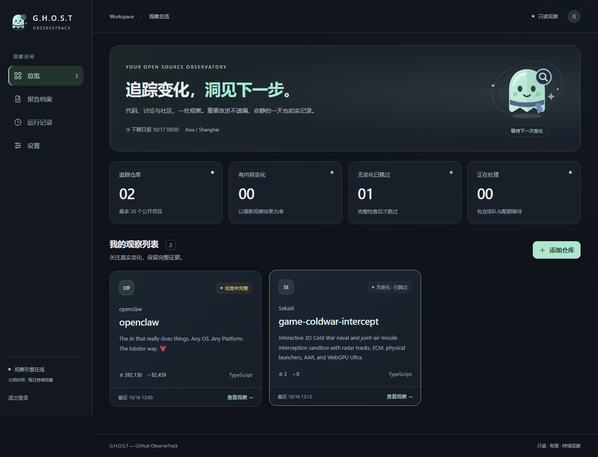
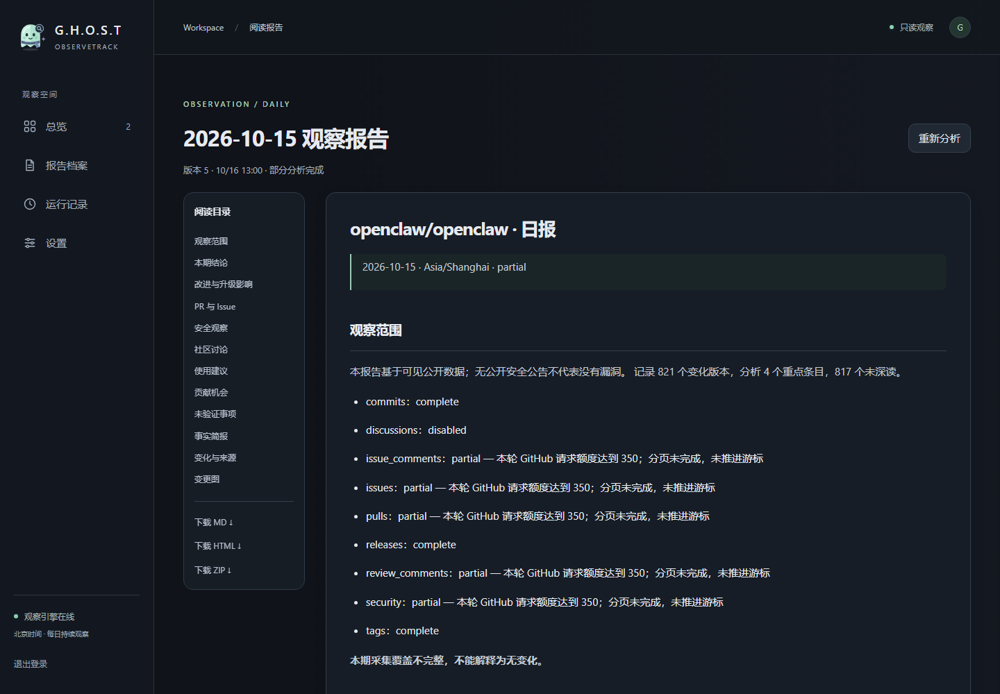
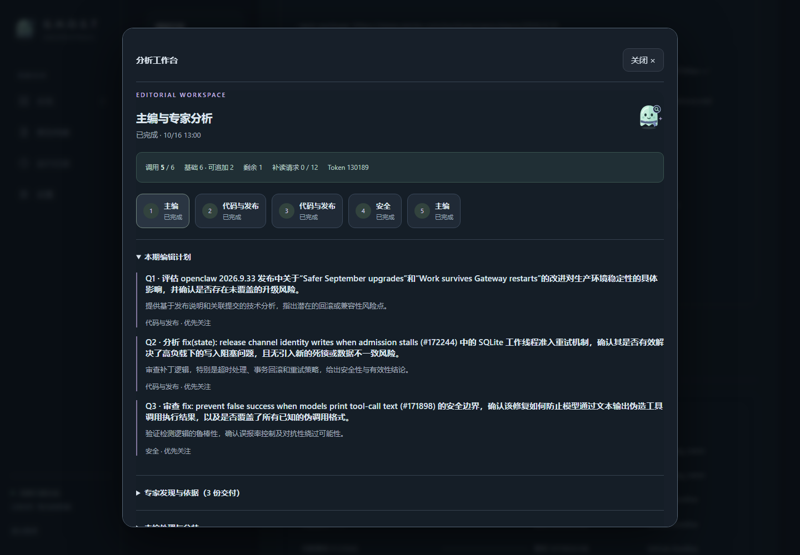
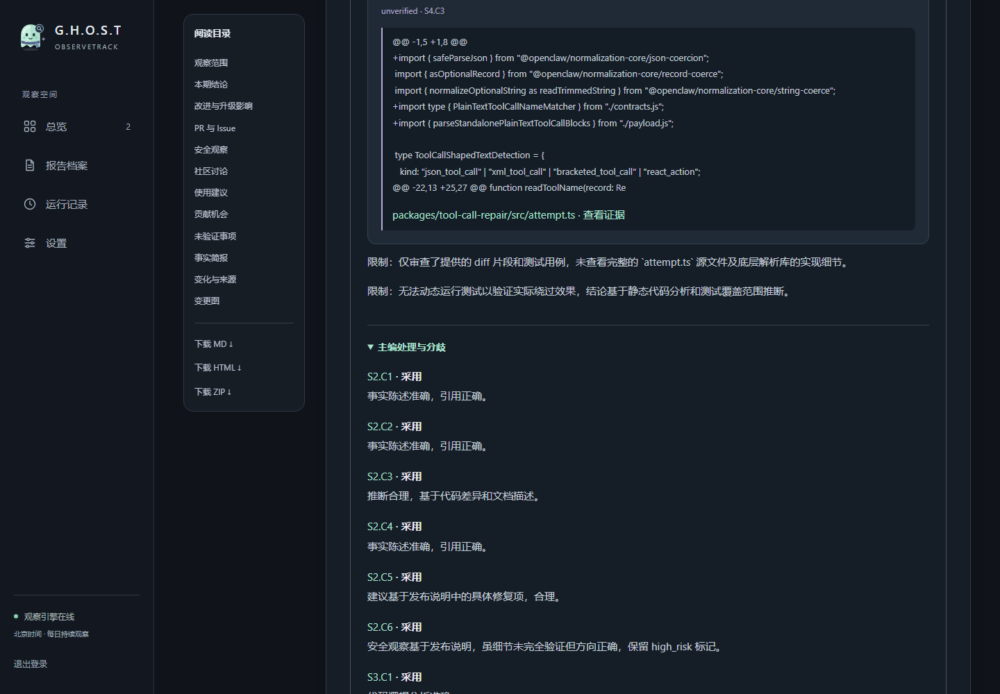
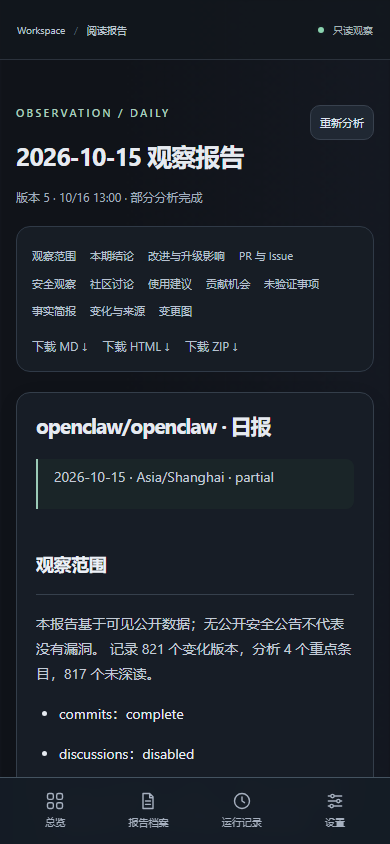
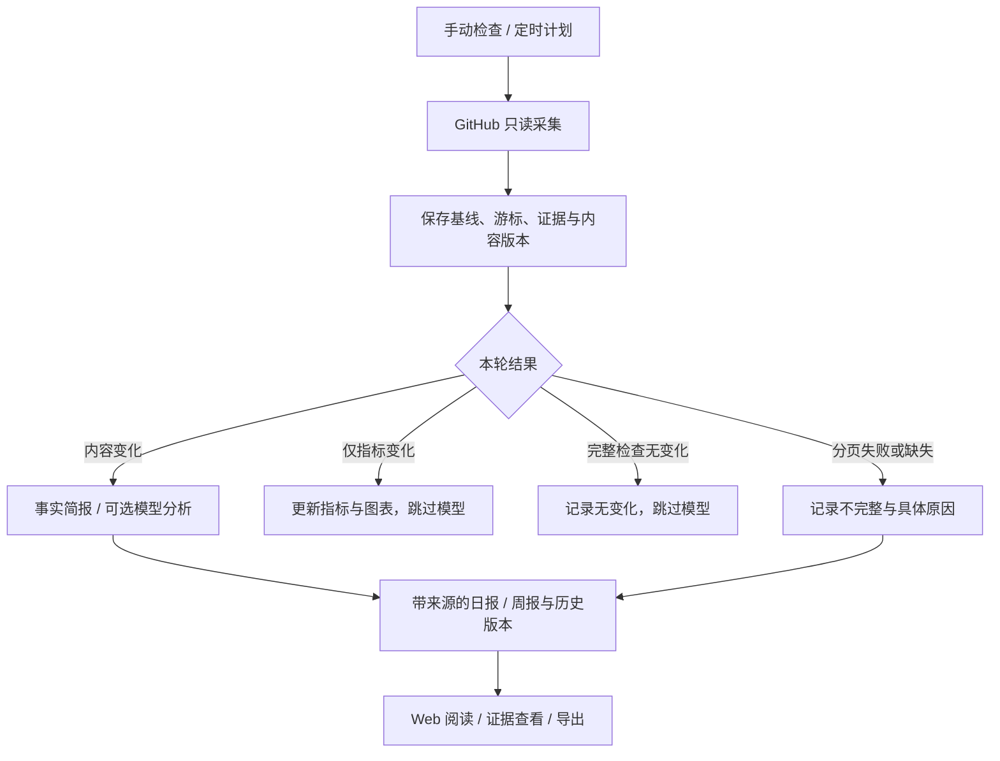

# ObserveTrack

**把 GitHub 仓库的变化，整理成可以追溯来源的日报和周报。**

**简体中文** · [English](README.en.md)

[](LICENSE)

ObserveTrack 是一个可独立部署的 GitHub 公开仓库观察工作台。它定期采集代码、发布和社区活动，保存变化与证据，再使用可选的模型分析生成中文报告。从总览发现更新，进入报告阅读结论，再回到引用的原始材料核对依据。

适合跟踪依赖项目、了解上游版本变化、整理技术情报，以及为团队积累有时间线的项目观察记录。没有配置模型时，仍可保留采集结果并生成事实简报。

> GitHub 访问只读，不发布评论、Issue 或 PR。不包含通用聊天代理或代码执行沙盒。当前界面与默认报告语言为中文；本项目提供完整中英文说明文档。

## 实际界面与成果

以下均为 **2026 年 10 月历史运行的真实截图**，不是效果图，也不代表当前实时状态。截图保留原有 GHOST 品牌；公开版本延续该界面。示例涉及公开仓库，所展示结论仍需核对证据。完整原图与说明见[截图来源](docs/images/README.md)。

### 仓库总览

查看追踪仓库、变化状态、采集进度和下一次计划时间；“无变化”与“采集不完整”分别呈现。



### 生成的日报与覆盖范围

报告包含观察范围、变化条目、结论、建议、未验证事项和来源。下面的实际日报记录了 **821 个变化版本，其中 4 个重点条目被分析，817 个未深读**；报告明确标注 `partial`，不将其包装成完整审计。



### 可选的主编与专家分析

分析工作台展示本期问题、阶段进度、调用预算和专家交付。图中历史运行使用了 **5 次模型调用**；这只是一次实际记录，不是每份报告固定消耗。



### 报告中的证据与限制

除了摘要，还展示引用的代码片段、证据入口、主编处理结果及限制。此例明确说明只检查了静态差异片段，未运行动态测试。



<details>
<summary>查看移动端报告实图</summary>



</details>

## 功能一览

| 能力 | 实际行为 |
| --- | --- |
| 公开仓库监控 | 最多追踪 20 个仓库，支持手动检查和定时采集 |
| 九类活动采集 | 提交、Releases、Tags、Issues、Issue 评论、PR、Review 评论、Discussions、公开安全公告 |
| 增量变化识别 | 保存基线、游标和内容版本，区分内容更新、指标变化、无变化与未完整采集 |
| 可追溯证据 | 保存采集快照与报告版本，阅读报告时可回看来源和证据 |
| 日报与周报 | 汇总代码与发布、社区活动、安全观察、建议及未验证事项 |
| 可选模型分析 | 使用兼容 OpenAI Chat Completions 的接口；未配置时保留事实简报 |
| 可选 V2 分析 | 主编规划、专家分析、主编整理，展示过程和用量；中断后可手动继续 |
| 图表与导出 | 使用真实采样生成 SVG 图表；报告支持 Markdown、HTML、ZIP 下载 |
| 独立工作台 | 单管理员登录、运行记录、计划时间、保留期限和预算设置 |

## 工作原理



### 先建立基线，再追踪增量

添加仓库后，首次采集建立当前基线，并回补最近 7 天能获得的活动。后续通过游标和内容版本识别新内容，避免把同一条记录重复当成新变化。

星标等指标变化保留到趋势图，但不会仅为数字变化调用模型。图表来自实际采样，不倒推出项目加入前的历史星标。

### 把“没有变化”和“没有采全”分开

只有完整检查后未发现变化，才记录为无变化。API 限流、权限不足、分页失败、禁用的讨论或达到请求预算，都会保留对应状态。部分数据依然可以形成报告，但报告显示覆盖范围和限制。

### 从证据生成报告，保留版本

选中的公开活动、发布说明和代码差异成为分析材料。模型解释与事实记录分开呈现，保留引用、来源和未验证事项。重新分析产生新的报告版本，便于回看旧结论。

可选 V2 加入主编规划和专家分工：先确定值得研究的问题，再组织证据与专家分析，最后整理结论及分歧。这会消耗多次模型调用，不是固定成本的一次摘要。

### API 与 worker 分工

FastAPI 提供登录、工作台和数据接口；独立 worker 执行采集、调度与报告任务。二者使用同一数据目录中的 SQLite。浏览页面不等于运行采集，**只启动 API 不会执行后台任务**。

## 快速开始

需要 **Python 3.12+**、**Node.js 22.12+**（推荐 Node 24 LTS）和 Git。前端构建后由 API 直接提供，不需要额外启动前端服务器。

### 1. 获取代码并安装后端

```sh
git clone https://github.com/Artistkisa/ObserveTrack.git
cd ObserveTrack
python -m venv .venv
```

Linux / macOS：

```sh
source .venv/bin/activate
python -m pip install -r requirements.txt
cp .env.example .env
```

Windows PowerShell（直接使用虚拟环境解释器，无需修改执行策略）：

```powershell
.\.venv\Scripts\python.exe -m pip install -r requirements.txt
Copy-Item .env.example .env
```

### 2. 配置独立密码

编辑根目录 `.env`，至少设置：

```dotenv
OBSERVE_DATA=data
OBSERVE_ADMIN_PASSWORD=replace-with-your-own-strong-password
OBSERVE_SECURE_COOKIE=false
```

`false` 只用于本机 HTTP。公网使用 HTTPS，并设置 `OBSERVE_SECURE_COOKIE=true`。不要提交 `.env`；进程环境变量优先于文件配置，程序不会自动读取其他项目的凭据文件。

### 3. 构建前端

```sh
cd frontend
npm ci
npm run build
cd ..
```

Windows 若 PowerShell 阻止 `npm.ps1`，使用 `npm.cmd ci` 和 `npm.cmd run build`。

### 4. 分别运行 API 和 worker

从项目根目录、同一虚拟环境打开两个终端：

```sh
# 终端 A：Web / API
python -m uvicorn observetrack.app:app --host 127.0.0.1 --port 9420
```

```sh
# 终端 B：后台采集与报告
python -m observetrack.worker
```

Windows 将以上两处 `python` 替换为 `.\.venv\Scripts\python.exe`。两个进程的工作目录、`OBSERVE_DATA` 和配置必须一致。

打开 **http://127.0.0.1:9420**，使用配置的管理员密码登录。新实例从空数据开始，不携带示例仓库或历史报告。

## 使用流程

1. **添加仓库**：输入公开仓库的 `owner/repository`，例如 `python/cpython`。
2. **建立基线**：手动检查，无需等待计划；在运行记录查看结果与失败原因。
3. **确认覆盖范围**：先看哪些维度完成、被禁用或未采全，再解读数量。
4. **阅读报告**：查看日报或周报中的发布、PR 与 Issue、安全观察、建议和未验证事项。
5. **核对证据**：沿引用返回保存的证据和公开来源；模型判断不代表运行测试或完整安全审计。
6. **导出与持续观察**：下载 Markdown、HTML 或 ZIP，在设置中调整时间、保留期限和预算。

默认时区为 **Asia/Shanghai（北京时间）**：

| 计划 | 默认时间 | 范围 |
| --- | --- | --- |
| 采集 | 每天 07:30 | 仓库增量活动 |
| 日报 | 每天 08:00 | 前一天 |
| 周报 | 每周一 08:30 | 前一周 |

设置中可调整计划时间。运行记录包含任务状态和模型调用信息；调用中断后不会自动盲目重放，需要明确重试或继续。

## 配置参考

| 变量 | 必需 / 默认 | 说明 |
| --- | --- | --- |
| `OBSERVE_DATA` | 默认 `data` | SQLite 与 worker 锁的目录；生产建议使用绝对路径 |
| `OBSERVE_ADMIN_PASSWORD` | 登录必需 | 独立管理员密码；修改并重启 API 会注销旧会话 |
| `OBSERVE_GITHUB_TOKEN` | 可选 | 提高公开 API 可用配额并访问需要授权的维度；Discussions 需要 Token |
| `OBSERVE_MODEL_BASE_URL` | 模型分析必需 | 兼容 Chat Completions 的基础地址，按供应商要求包含版本路径 |
| `OBSERVE_MODEL_NAME` | 模型分析必需 | 供应商实际支持的模型 ID |
| `OBSERVE_MODEL_API_KEY` | 模型分析必需 | 模型服务密钥 |
| `OBSERVE_SECURE_COOKIE` | 本机示例 `false` | 公网 HTTPS 设置 `true` |
| `OBSERVE_ANALYSIS_V2` | 默认 `false` | 启用可选主编与专家分析 |
| `OBSERVE_ANALYSIS_V2_REPOSITORIES` | 默认空 | 逗号分隔的仓库内部 ID；空值表示全部仓库，仍需 V2 总开关 |

### 模型接口和费用

程序在基础地址后追加 **`/chat/completions`**，所以不要填写完整端点。例如供应商要求 `/v1` 时，基础地址以 `/v1` 结尾。项目不绑定特定供应商；需确认接口、模型 ID 和密钥相互匹配。

三个模型配置项缺少任意一项时，不调用模型，保留事实简报。配置模型后，选中的公开内容、代码差异与证据会发送给该服务，请自行评估其数据政策与价格。预算限制调用次数，不保证固定费用；V2 专家分工和追加分析可能增加调用及 Token 用量。

### GitHub 访问

仅支持公开仓库。部分 REST 数据可匿名读取，但配额较低；Discussions 等能力需要授权。按使用端点配置最低必要读取权限，并遵守限流。代码不提供仓库写入能力，也不需要为本工具授予提交代码或发布评论的权限。

## 数据、部署与维护

默认数据保存在 `data/observe.sqlite3`，包括仓库状态、证据、报告版本、任务及用量记录。默认保留 365 天，可在设置中降低。源码仓库不携带生产数据库、Token 或历史运行数据。

生产使用独立用户、数据目录、环境文件及单个 API / worker，通过 Nginx 提供 HTTPS：

- [Linux HTTPS 部署、升级与备份](docs/DEPLOYMENT.md)
- [API 服务模板](deploy/observetrack-api.service) / [worker 服务模板](deploy/observetrack-worker.service)
- [Nginx 配置示例](deploy/nginx.conf.example)

备份前停止 API 和 worker，保存环境配置与整个数据目录，包括可能存在的 SQLite WAL 文件。备份可能包含会话与证据，不要放在网站根目录或提交到 Git。

### 常见问题

| 现象 | 优先检查 |
| --- | --- |
| 页面可打开但任务不执行 | worker 是否启动，是否与 API 使用相同数据目录 |
| 不能登录 | 密码是否配置，修改后是否重启；本机 HTTP 不要开启 Secure Cookie |
| 只有事实简报 | 三个模型变量是否全部设置，运行记录是否有接口错误 |
| 报告显示 `partial` | 查看覆盖范围、分页错误、权限和预算，不要当作无变化 |
| 重启后分析未继续 | 在运行记录明确重试或继续，不确定的模型请求不会自动重放 |
| 没有历史星标曲线 | 只使用加入观察后的实际采样，不生成不存在的历史记录 |

## 限制与边界

- 最多 20 个仓库；每仓库同时最多 1 个任务，全局最多 2 个任务。
- 每轮 GitHub 请求预算为 350，单次分页最多 100 页；活跃的大仓库可能采集不全。
- Linux 使用文件锁防止重复 worker；Windows 只启动一个 worker。
- 无法恢复删除、隐藏或无权读取的内容；没有公开安全公告不代表不存在漏洞。
- 模型结论可能错误，静态差异分析不能替代运行测试、维护者意见或完整安全审计。
- 当前为单管理员、中文界面与默认中文报告，不提供多租户或完整国际化界面。

## 开发与验证

前端位于 `frontend/`，后端位于 `observetrack/`，测试位于 `tests/`。前端开发可在 `frontend` 运行 `npm run dev`，本机开发服务器将 `/api` 代理到后端。

```sh
python -m pip install -r requirements-dev.txt
python -m unittest discover -s tests -v
python scripts/smoke_local.py
python scripts/check_public_source.py
cd frontend
npm test
npm run build
```

本地开源准备验证包含 43 项后端测试、2 项前端测试、生产构建，以及独立 API / worker、登录与空数据烟雾检查。变化处理使用模拟 GitHub 和模型接口测试；截图来自较早的真实运行，不代表本轮本地测试调用了线上模型。日期与范围见[检查记录](docs/RELEASE_READINESS.md)，CI 定义见 [.github/workflows](.github/workflows)。

## 许可证与来源

**Apache-2.0 · Copyright 2026 Kisara-Lab**。

ObserveTrack 源于 GHOST 的仓库观察模块，现独立维护。保留经授权的代码适配和幽灵图形，来源与第三方依赖另行说明：

- [许可证](LICENSE) / [NOTICE](NOTICE)
- [来源记录](PROVENANCE.md)
- [第三方声明](THIRD_PARTY_NOTICES.md) / [依赖许可证原文](THIRD_PARTY_LICENSES.txt)
- [安全问题报告](SECURITY.md)

前端包的 `private: true` 仅防止误发布到 npm，不影响按 Apache-2.0 使用项目代码。
